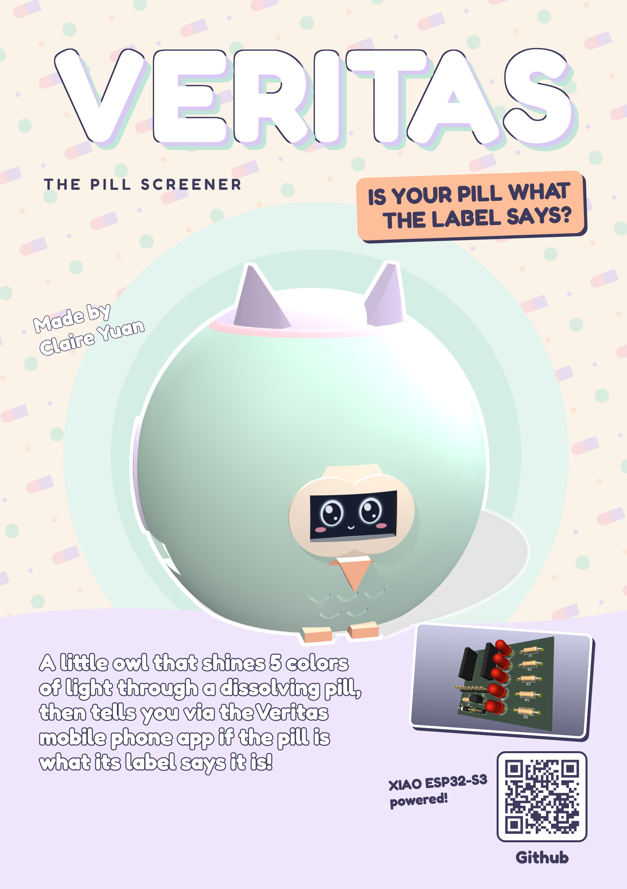
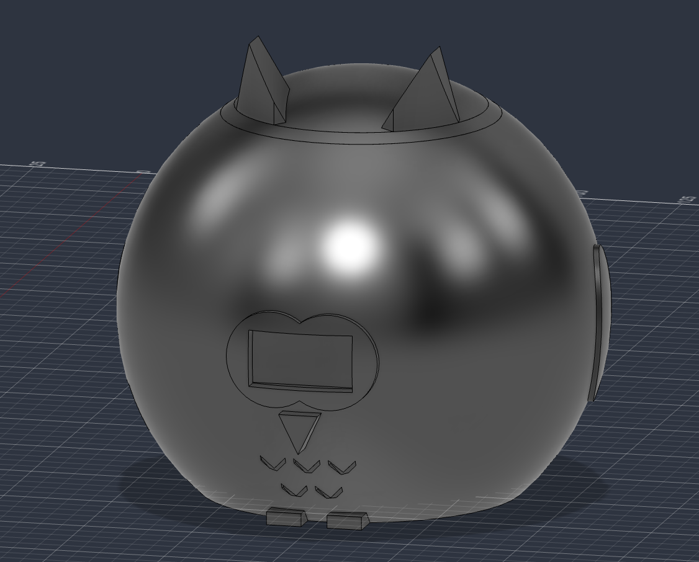
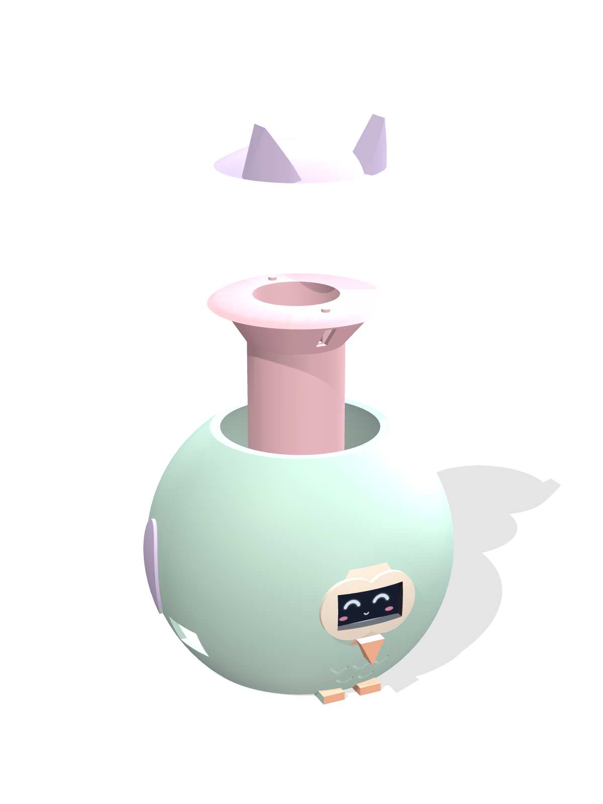
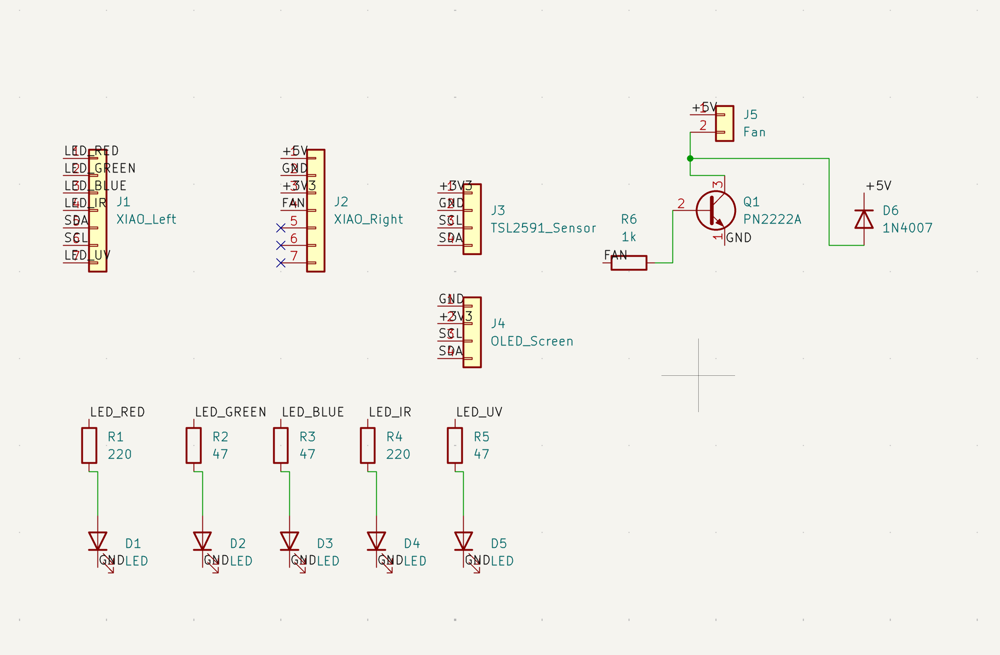
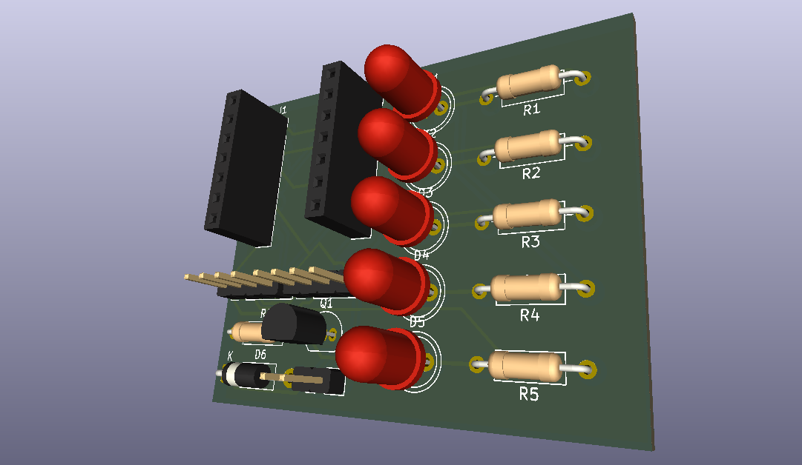
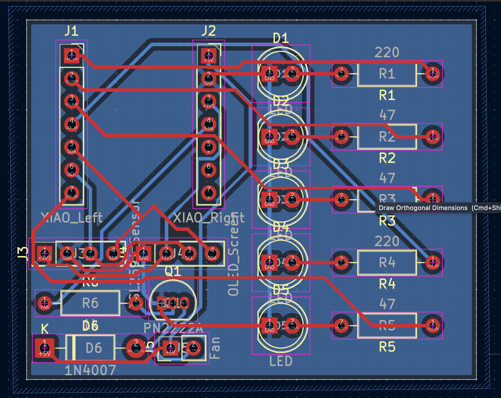

# Veritas: A Pill Screener
Veritas is a small owl-shaped pill screener that uses water dissolution and light sensing to check whether an over-the-counter pill matches what the pill's label says.

To use Veritas, first you take a small glass vial of water that is provided alongside Veritas, and then drop the pill inside. Then, you shake the vial for 10 seconds, and then set the vial back inside the owl. If you forget how to do any of these steps, fret not! The OLED screen will walk you through the process. 

Inside, Veritas will first shine five colors of LED (red, green, blue, infrared, and ultraviolet) through the dissolving pill, in that order. Then, a light sensor inside will measure how much of each color makes it through the dissolved pill. These five numbers are the main data points Veritas will send to the mobile app over Bluetooth, which will then start a process of the app comparing the scan of the pill with the known data points of that pill. The mobile app will then send the readings back to the OLED screen, which will then output the result (Math, Doesn't Match, or Inconclusive).
## Why I made Veritas
The WHO estimates that 1 in 10 medical products in low and middle income countries is substandard or falsified. Given the current state of the US' healthcare system, most people have low access to proper lab tests, and when they do, they're often expensive and slow. Most people have no way to check a pill at home.

Owls are known for being wise, which inspired the design of Veritas. Moreover, truth in Latin (and partially Yale's latin motto) inspired the name "Veritas." 

## Features

+ 5 Colors of light shined: red, green, blue, 940 nm infrared, and 400 nm UV
+ TSL2591 high sensitivity light sensor
+ 0.96" OLED screen
+ Seeed XIAO ESP32-S3 with Bluetooth Low Energy 
+ Custom 50 x 40 mm PCB
+ 3D printed 110 mm owl case 
+ USB-C Connection

## Case

The case is a 110 mm sphere with a flat bottom designed in Autodesk Fusion. The case breaks down into 3 parts: 

+ the body with the PCB at the bottom, the cutout for the OLED, the beak, wings, chest feathers, and feet.
+ the chamber for the vial to stand, right above the LEDs, which fits standard sized glass vials (approx. 27 x 60 mm)
+ the roof/sensor cap where the TSL2591 sensor is mounted

The parts are held together with heat-set inserts, to which Im printing in black PLA so as to not let any light in and interfere with the readings.

## PCB

Using KiCad, the PCB ended up being about 50 x 40 mm. The XIAO ESP32-S3 plugs into two 7 pin headers so it can be swapped out whenever. The five LEDs sit in a column under the chamber so their light goes straight up the vial to the sensor. Each LED has its own current-limiting resistor to which the light sensor and the OLED connect with 4 pin headers. 

There's also a spot for a small transistor and diode that could drive a stirring fan, which was left unpopulated for the purposes of Veritas as I found shaking the glass vial by hand works fine. 
The gerbers are in pcb/veritas/gerbers.zip and can be ordered from JLCPCB.

## Schematic

## Firmware
The firmware is in firmware/veritas/veritas.ino and was written in Arduino's desktop IDE. The code essentially covers the commands for the OLED screen display and the Bluetooth connection to the mobile app. 

### Libraries used: 

+ Adafruit TSL2591 library 
+ Adafruit unified sensor 
+ Adafruit SSD1306
+ Adafruit GFX library 
+ ESP32 BLE

## App

The mobile (iPhone) app is written in Swift with SwiftUI (in 'app/'). The app connects Veritas over Bluetooth, starts scans, saves reference scans of the actual, known pills, and compares new scans against them to decide Match, Doesn't Match, or Inconclusive. The app is still a work in progress, which will be finished in tandem with the hardware portion of Veritas.

## Bill of Materials

See [BOM.csv](BOM.csv) for the full list of parts with links and prices. 

## Credits

Component footprints and 3D models are from the standard KiCAD libraries. The XIAO ESP32-S3 model in the renders is a placeholder. 

Libraries by Adafruit(TSL2591, SSD1306, GFX) and Espressif (ESP32 BLE).

